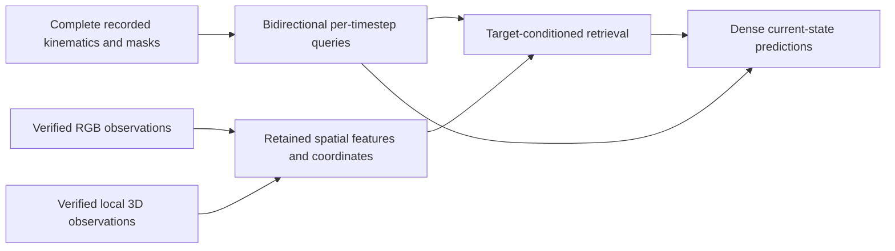

# Offline pedestrian labeling: literature review and next research direction

Reviewed **2026-10-13**. This records an evidence-based **recommendation**, not an execution-ready experiment or an established novelty claim. E001/E001b results, populations, splits and accepted policies are unchanged. [Research owner](../research.md) · [paper index](README.md) · [five-seed results](../../experiments/E001b-2d-bbox-contribution/results-review.md).

## Recommendation and decision resolved

Prioritize a **reproducible empirical study of offline behavior labeling under incomplete observations**, supported by an established multimodal reference. Preserve enough spatial information to test **one small complete-track-conditioned retrieval mechanism** if the reference exposes a relevant limitation. Keep heterogeneous supervision as a meaningful RQ2 experiment, conditional on a usable auxiliary source and remaining time; do not make a large fusion architecture, new foundation-model pretraining or a third dataset a prerequisite for the December deliverable.

The literature resolves an architectural obligation: **a Transformer is a comparison option, not the required successor to BiLSTM**. Nor does it establish that joint raw scene/time processing is necessary. The next scientific decision is which additional evidence resolves identified class errors, followed by whether retaining/querying spatial tokens helps beyond ordinary feature fusion. This explicitly revises the previous provisional Transformer-first E002→E003→E004 sequence; both RQs remain valid, but their implementation dependencies and deadline priority change.

There is substantial neighboring work on current pedestrian actions, four-state annotations, 3D crossing recognition, target-conditioned scene attention and offline dense action segmentation. **No methodological equivalence to the entire proposed protocol was established in this focused review**, but absence from this search is not evidence of firstness. An empirical or benchmark contribution must show what its controls reveal; combining familiar components or naming a new dataset pair is insufficient.

## Reading scope and evidence standard

Eight close works received deeper task/protocol reviews: [LOKI](papers/loki-method.md), [ROAD-Waymo](papers/road-waymo-method.md), [TITAN](papers/titan.md), [PePScenes](papers/pepscenes.md), [3D-keypoint crossing](papers/3d-keypoint-crossing.md), [nighttime recognition](papers/nighttime-recognition.md), [CrossFeat](papers/crossfeat.md) and [MulCPred](papers/mulcpred.md). Additional focused notes cover adaptable baselines, spatial/time mechanisms, encoder interfaces/provenance and the few secondary supervision/reliability questions. The count expanded beyond the initial 15–20 because recent checkpoint families differ materially from their names/papers; this was not an exhaustive encoder or pedestrian-prediction survey.

Primary methods/results and relevant supplementary sections were checked. Official repositories/model cards were read for availability and interfaces; **no architecture was implemented, checkpoint executed or training run launched**. Published numbers are contextual evidence, not comparable rankings. [Pedestrian Graph+](papers/pedestrian-graph-plus.md) remains a repository-level check, explicitly short of a full-paper review. Existing [self-labeling](papers/minimizing-human-labeling.md) and [motion-transfer](transferable-motion-representations.md) notes are retained rather than duplicated.

The user supplied both previously inaccessible full texts; their access gaps are resolved. Open-access PDFs and source hashes, supplied-PDF hashes/paths, repository snapshots and checkpoint file metadata are retained locally under ignored `outputs/inspection/literature/20261013-review/`; [source manifest](../../outputs/inspection/literature/20261013-review/sources.json). Those local files are machine-specific; every paper note also links its portable primary source. A linked checkpoint is distinguished from downloaded/runtime-verified weights. Exact code/weight revisions must be frozen when an experiment is defined.

Searches covered recognition, dense labeling, action detection, given tracks, LiDAR/context, trajectory-conditioned representations and relevant releases through 2026. The main new 2026 checks are [Utonia](papers/utonia.md), [OmniVGGT's CVPR release](papers/omnivggt.md), [nighttime recognition](papers/nighttime-recognition.md) and the [ViCross preprint](papers/vicross.md). Titles/abstracts alone were not used to declare temporal equivalence.

## Closest-work comparison

### Implications of the completed baseline evidence

The [joint five-seed report](../../experiments/E001b-2d-bbox-contribution/results-review.md) supports retaining a temporal reference: BiLSTM improves on matched MLP configurations, although extra capacity is not isolated. RAW versus K+T+R depends on direction, so a more structured feature set is not automatically better. Bbox geometry improves LOKI→ROAD by **5.51 ± 0.50 pp** over availability, yet primarily helps Stopped while Waiting worsens; the other directions are mixed. This motivates testing road/appearance evidence and semantic boundaries before adding fusion complexity. It does not prove those modalities will help, that Waiting is intrinsically ambiguous, or that the larger temporal model's gain comes solely from future context. All attempts stopped below epoch 75; increasing the cap is not the identified research need.

### Published task and baseline alignment

“Adapted baseline” means retraining a documented representation/head under our observations, dense targets, masks, source selection and metrics. It does not mean comparing a published forecasting/detection score directly with our F1.

| Work | Actual output and temporal access | Actual evidence / target conditioning | Comparison value and substantive difference |
|---|---|---|---|
| [LOKI, ICCV 2021](papers/loki-method.md) | Joint future trajectory/intent; short history; original four current actions shifted for prediction | Metric tracks, goals and scene-graph/context information; not a raw RGB–LiDAR recognizer | Closest ontology. Adapt unshifted dense head without GT action history; full-track reconstruction/transfer remains different |
| [ROAD-Waymo, v3](papers/road-waymo-method.md) | Frame/tube action/location/event detection; short RGB clips | I3D/SlowFast video and predicted boxes/tubes | Closest road-action benchmark. Adapt video features at given boxes; detection mAP and AV-action segmentation are not pedestrian-state F1 |
| [TITAN, CVPR 2020](papers/titan.md) | Current hierarchical action recognition plus future forecasting | Supplied target crop histories, ego/interaction priors | Given-instance multi-action recognition already exists. Adapt crop head; no raw 3D/missing-RGB behavior evaluation |
| [PePScenes, 2020](papers/pepscenes.md) | Binary future crossing; short pre-event observations | RGB scene, semantic map, metric 3D track and ego velocity; spatial-first pooling | Direct multimodal precedent. Adapt fusion; no raw point features, four-state dense output or full 3D-only population |
| [Li et al., ICRA 2023](papers/3d-keypoint-crossing.md) | **Current** binary crossing plus future trajectory from history | LiDAR-derived 3D pose, target track, road/agent attention; auxiliary temporal tasks | Strong recognition/3D precedent. Private crossing results; public Waymo evaluates forecasting only; full reproducible behavior pipeline unverified |
| [Zhang et al., 2026](papers/nighttime-recognition.md) | One of three behaviors per sampled full video sequence | DINOv2 crops + motion/interaction descriptors + temporal Transformer | Strong economical reference. Adapt CLS to dense head; fixed roadside camera, no Stopped state, no 3D-only/transfer setting |
| [CrossFeat, T-IV 2024](papers/crossfeat.md) | Future Crossing/Stop/Go from past history | Temporally encoded target/attribute queries cross-attend to current semantic spatial tokens | Closest retrieval mechanism. Adapt without oracle behavior attributes; complete observed track and cross-time scene retrieval are different hypotheses |
| [BiPed, ICCV 2021](papers/biped.md) | Binary future crossing, trajectory and final location; short pre-event history, main model also uses future ego motion | Target-specific semantic-category CNN/LSTMs; temporal attention; independent/shared task encoders | Semantic-context and auxiliary-supervision baseline. Adapt dense head and match access; reported scene gains chiefly concern trajectories |
| [MulCPred, Sensors 2024](papers/mulcpred.md) | Crossing/atomic-action prediction; short windows | Appearance, pose, trajectory, ego and local-context concepts | Closest explainable multimodal/transfer study. Do not invent novelty for named factors; natural missingness and dense 3D labeling differ |
| [Xiong et al., STRC 2022](papers/simple-action-recognition.md) | Current actions; framewise or pose-sequence recognition | Supplied-ID 2D joints; small MLP/LSTM | Cheap adapted recognition baseline. Pose availability/road context and population must be matched |
| [ASFormer, BMVC 2021](papers/asformer.md) | Offline dense per-timestep actions from video features | Local/hierarchical temporal attention and iterative refinement | Adaptable temporal baseline. Already establishes non-causal dense labeling; benchmark activities and segment metrics differ |
| [Zhou & Zeng, RAS 2024](papers/pedestrian-partial-supervision.md) / [Mordan et al., T-ITS](papers/detecting-32-attributes.md) | Current attributes and crossing-related outputs; image/history models | Shared visual/task features; staged component datasets or partial JAAD labels | Partial pedestrian supervision already exists. Neither establishes our joint heterogeneous RGB/3D dense-label transfer experiment |

Published methods do **not** all forecast intention: TITAN has recognition, Li et al. recognizes current crossing, ROAD recognizes actions, and the nighttime method uses sequence recognition. Conversely, “recognition” in a title does not prove dense full-track output, and multiple modalities in a dataset do not prove that a method consumes them.

## Architectural design space

Let `T` be track timesteps and `S` the retained spatial tokens per timestep. All candidates below are allowed complete recorded observations. This avoids conflating architecture with past/future access.

| Approach | What it preserves / may discard | Evidence and empirical limits | Requirements and cost | Recommended role |
|---|---|---|---|---|
| **A. Spatial-first:** encode/pool each timestep, then temporal head | Preserves temporal sequence and chosen per-frame descriptors; pooling may discard locations/relations that become relevant later | Nighttime, PePScenes and LiMTR are strong precedents. Their scores do not show this bottleneck limits our task | Native crops/local 3D features, masks; cacheable frozen RGB; cheap temporal head | Required established reference; useful final labeler if sufficient |
| **B. Pedestrian-conditioned spatial-first:** select/query target-specific scene features before temporal head | Retains relative geometry and useful scene detail before compression; a frame-local query can still miss information revealed later | CrossFeat already does target/history-conditioned spatial retrieval. Li et al. models target–road/agent interaction | Native 2D association and independent 3D coordinates; token/ROI budgets; camera calibration only for cross-sensor projection | Defensible first attention comparison after scene utility is demonstrated |
| **C. Joint/hierarchical space-time:** temporal queries revisit retained scene tokens; optional local 4D encoding | Allows later observations to change which earlier spatial evidence is read; preserves more intermediate information, not raw information without loss | TubeDETR, Scene Transformer and P4Transformer establish these principles in other tasks. No reviewed evidence proves superiority on our four states/population | Pose/timing alignment for 3D accumulation; gaps/masks; bounded token memory. Flat attention grows roughly as `(T×S)²` | One bounded candidate mechanism; full raw-token joint training deferred |

Pooling is not automatically a fatal information loss: a sufficiently task-relevant descriptor may already be adequate. Joint models also compress, and a frozen encoder may have discarded tiny-pedestrian detail before attention begins. The claim to test is **whether delayed target-conditioned retrieval matters for identifiable errors**, not whether more tokens are theoretically always better.

### Initial representation and backbone recommendation

Use metric kinematics as a persistent path, plus **independent target/context RGB and local 3D scene branches**. Start with native box crops and a compact LiDAR-only local BEV or point encoder. Fuse descriptors with an established bidirectional temporal head and predict a state at every non-padding slot. Keep no-RGB tracks eligible and preserve source-only loss/normalization/selection conventions in the new protocol. Current RAW and K+T+R references remain useful; do not choose the new representation by the best target score.

Native 2D crops and a LiDAR-only branch do not require camera–LiDAR projection. Verified cross-sensor calibration is required for colored points, aligned depth, shared camera/LiDAR BEV or projected crops for 3D-only tracks. Missing target crops, missing scene images, missing point measurements and missing GT need independent meanings. Absence of a 2D annotation does not certify out-of-FOV status. No unverified calibration reconstruction should become a dependency.

For RGB, a **small frozen DINOv2** is an adequate initial reference; a small DINOv3 can replace it once access/interface are settled, without an encoder benchmark. For 3D, a compact source-trained branch gives a cleaner exposure reference. **Utonia is the most directly compatible reviewed pretrained point interface for absent color/normals**, but belongs to a separately disclosed external-exposure comparison until its recording overlap is resolved. PTv3 itself is not a checkpoint choice. Full OmniVGGT/BEVFusion are not recommended initial dependencies.

Keep BiLSTM as a functioning temporal reference. One small full-track Transformer or ASFormer-like model can establish an adapted published temporal comparator; it need not outperform BiLSTM to be useful. Do not require a backbone change before assessing scene evidence, or change the backbone simultaneously with modality/query mechanism and attribute gains to fusion.

### One narrowly testable offline mechanism

**Hypothesis:** a timestep's scene query formed from the complete observed pedestrian trajectory can select behavior-relevant spatial evidence better than a query formed before temporal reasoning.

The smallest candidate is two passes over **frozen/cached spatial features**: a bidirectional kinematic track encoder produces per-timestep queries; those queries retrieve from retained scene tokens; a dense readout combines the result with the motion path. Start with time-aligned retrieval. Only add retrieval across other recorded frames if specific occlusion/context errors justify it. This is lighter than joint training of raw RGB and 4D point clouds.

This diagram is a **candidate data flow**, not an accepted software design. TubeDETR/CrossFeat/Scene Transformer are near art. A new mechanism would need a precise distinction and mechanism-isolating ablations; a standard time-query decoder may suffice and would weaken the method claim.

Required mechanism controls use the **same observations, frozen encoders and complete future access**: pooled features + temporal head; frame-conditioned retrieval + temporal head; complete-track-conditioned retrieval; pooled features with the same complete-track summary and comparable added parameters. If cross-time retrieval is attempted, compare it separately with time-aligned retrieval. Measure class/condition effects and compute, not only global F1. Attention plots illustrate selection but do not prove causal explanation.

## Encoder shortlist and access implications

| Candidate | Actual spatial interface / pretrained status | Exposure and alignment | Practical recommendation |
|---|---|---|---|
| [DINOv2](papers/dinov2.md) | RGB patch/CLS features; official small checkpoints/API | LVD-142M web curation; exact recording intersection unknown. No calibration for native crops | Preferred economical RGB reference; retain patches if later retrieval is tested |
| [DINOv3](papers/dinov3.md) | Dense image features; small distilled models/checkpoint access | LVD-1689M natural images; distinct satellite family; exact intersection unknown | Alternative single choice, not another model grid |
| [PTv3](papers/ptv3.md) | Hierarchical point features; backbone/code, not a single pretrained representation | Per-model channels/scales; outdoor weights/exposure vary; official stale-weight warning | Foundation for an optional point branch, not mandatory full fine-tuning |
| [Sonata](papers/sonata.md) | Published encoder-only point features/inverse mappings | Default color+normal interface; indoor and outdoor training separate | Conditional frozen probe; original indoor model is not an outdoor headline checkpoint |
| [Concerto](papers/concerto.md) | Image-to-point pretrained spatial features | Calibration during paired training; original vs Utonia-derived/outdoor weights differ | Useful representation-learning precedent; pin the actual variant |
| [Utonia, ICML 2026](papers/utonia.md) | Published point features; missing color/normals explicitly supported | **Waymo/nuScenes pretraining**; grid/scale/pose remain relevant | Best technical pretrained 3D candidate; qualify access before scientific use |
| [OmniVGGT](papers/omnivggt.md) | RGB sets + optional image-aligned depth/cameras; spatial tokens and geometry heads; published weights | **Waymo pretraining**; raw LiDAR requires projection; cannot operate as our RGB-free point encoder | Defer; not a shortcut around missing verified calibration |
| [MIT BEVFusion](papers/bevfusion.md) | Shared calibrated BEV features; nuScenes checkpoints | Known perception supervision, calibration, older archived implementation | Defer full fusion; a small LiDAR-only BEV is a different cheap reference |

**2026-10-15 follow-up:** [concrete PTv3 files and saved configurations](papers/ptv3.md#concrete-outdoor-checkpoint-follow-up-2026-10-15) identify an official nuScenes-supervised checkpoint and [D-DITR](papers/ditr.md) point-only distilled alternatives. [Utonia's actual pretraining configs](papers/utonia.md#verified-pretraining-partitions-2026-10-15) include both Waymo training/validation; nuScenes and SemanticKITTI entries include train/val/test. These checks do not execute a checkpoint or change E001. They refine the exposure/availability assessment rather than select an encoder.

Three exposure questions must be answered separately: **did pretraining use the target corpus, did it use evaluated recording IDs, and did it use their labels?** Unlabeled exposure can violate dataset-excluded transfer without behavior labels. A Waymo checkpoint can also have seen our ROAD **source test** clips: E001's experimental split is not a checkpoint's pretraining split. Do not infer safety from the word “train” in a public checkpoint description. Removing a head, freezing weights or fitting only source behavior labels does not erase exposure.

Keep a scratch/source-only reference under the existing strict access rules. Practical externally pretrained labelers can still be valuable, but must carry their own access description and must not establish a claim about unseen target observations or the effect of later auxiliary supervision. Unknown web-image intersections are explicitly unknown, not certified absent. For an RQ2 comparison, use the **same initial checkpoint** in every arm so the incremental supervision effect is identifiable; disclose any earlier exposure to the auxiliary corpus.

## Strongest contribution candidates

No “first” or established methodological novelty is claimed. These are ordered by combined scientific promise and feasibility for **17 December 2026**, with 7–17 December protected for buffer/handover.

### 1. Empirical and benchmark contribution: what supports reliable offline labels?

**Novelty hypothesis:** a reproducible given-track, dense current-state setting exposes meaningful behavior-specific limits and transfer failures obscured by pre-event binary selection, RGB-only populations and detection-based scores. Its value comes from the controls and findings, not the dataset combination alone.

**Nearest art:** LOKI's states; ROAD/TITAN action recognition; PePScenes multimodal ablations; MulCPred/ViCross transfer; Riaz automatic labeling. The genuine possible difference is their combined evaluation under incomplete native observations, matched populations and explicit semantic/exposure accounting.

**Minimal decisive evidence:** established dense temporal and multimodal references; kinematics versus RGB/context versus local 3D versus both on the same GT; class and observation support; same-seed transfer effects; a bounded blinded audit of Stopped/Waiting and Crossing/Moving examples with controlled evidence access. Report mistakes and annotation disagreement without calling low F1 a sensor-information upper bound. Add source-calibrated risk–coverage/class-retention diagnostics only after a viable labeler exists.

**Falsifier/limit:** if annotation inconsistencies or missing associations dominate, the result is a narrower annotation/protocol investigation, not sensor recoverability. If simple baselines explain everything, architectural novelty is unnecessary but the empirical claim still needs non-obvious, reproducible findings. No theorem of intrinsic ambiguity follows from model/human disagreement.

**Feasibility/publication role:** highest. Existing five-seed evidence and saved masks/predictions provide the foundation. A strong empirical paper can remain coherent after negative multimodal results. Public release must respect native licenses: release code/manifests/projections/splits and derived metrics rather than redistributing restricted raw data.

### 2. Method contribution: complete-track-conditioned scene retrieval

**Novelty hypothesis:** information revealed later in a recorded track helps choose which earlier spatial evidence matters **before pooling**, improving dense contextual states under partial observations. Future access alone is not new.

**Nearest art:** CrossFeat's history-conditioned current-scene queries; TubeDETR's temporal queries; Scene Transformer's trajectory conditioning; P4Transformer's joint geometry/time; ViCross target-centric tokens. The precise update/retrieval rule and the hypothesis it isolates would need to differentiate from ordinary adaptations.

**Minimal decisive evidence:** the four matched controls above, one fixed spatial encoder/temporal budget, source-only selection, support-aware class/condition effects, and a targeted time/context-removal control. If cross-time evidence is claimed, demonstrate improvement specifically where another observed frame contains relevant information. Use repeated central comparisons, not a large attention-model search.

**Falsifier:** equivalent performance from ordinary frame-conditioned attention or adding a track summary to pooled fusion; gains confined to extra future inputs, parameter count, modality flags or known dataset shortcuts. Then describe it as an established architecture adaptation and retain candidate 1.

**Feasibility/publication role:** moderate for a small cached-feature decoder; low for joint raw RGB/4D training. This is a conditional method component, not a promise of novelty or positive scores.

### 3. Representation/supervision contribution: complementary semantics improve transfer

**Novelty hypothesis:** one additional source with semantically complementary native annotations improves transferable offline behavior features beyond extra observations and generic auxiliary learning, while avoiding a forced universal taxonomy.

**Nearest art:** Mordan's partially labeled pedestrian tasks; Zhou & Zeng's staged multi-dataset pipeline; MSeg semantic reconciliation; MultiMAE/ActionMAE masked learning; BiPed's shared/independent auxiliary spatial tasks; Li et al.'s auxiliary pose tasks and the existing motion-transfer review. Native heads and loss masks themselves are established.

**Minimal decisive evidence:** behavior-only source training; same extra-source observations with a generic auxiliary objective; same observations with native semantic supervision. Keep inference representation, behavior labels, initialization and comparable exposure/compute fixed. One justified shared/native-head or shuffled/removed-semantic-label control can test whether meaningful semantics, rather than sampling, cause a benefit. Use only development data for decisions; retain negative transfer.

**Falsifier:** semantic supervision adds no benefit over generic learning; a gain vanishes under matched exposure or is explained by target-pretrained features. Conflicting labels or incompatible observations can invalidate the proposed semantic task before training.

**Feasibility/publication role:** conditional. One existing source such as nuScenes is preferable to collecting several datasets, but usable common representations/native scene-relation labels remain a gate. If no source is ready by the November gate, report RQ2 as unresolved and explicitly narrow December claims; do not fabricate an auxiliary target. A distinct RQ2 paper is more plausible than forcing three weak contributions into one narrative.

### Ideas already established, or not sufficient as novelty

Bidirectionality/future context; dense action labeling; temporal Transformers; target crops/queries; scene cross-attention; 4D point processing; concatenated pretrained encoders; masked modality reconstruction/dropout; partial-label native heads; auxiliary motion forecasting; cross-dataset evaluation; temperature scaling/rejection; automatic pseudo-labeling/smoothing. Specific new mechanisms or carefully controlled new evidence can still contribute, but these ingredients alone do not.

Reliability is best integrated into candidate 1: calibration and rejection without independent error/coverage evidence are standard techniques, not trustworthy annotation. A high-confidence benchmark error remains an error, and rejecting all rare states is not a useful full labeler.

## Essential next experiments and stopping rules

These are proposed research gates; no new comparison settings, numeric success threshold, final encoder or annotation sample budget is frozen by this document.

| Gate | Smallest useful next action | What it resolves / when to stop |
|---|---|---|
| Evidence/semantics | Source-development failure inspection with fixed state definitions; small qualitative/blinded evidence audit | Are road relation, appearance, temporal evidence or annotation disagreement responsible? Do not infer intrinsic ambiguity or use target errors to select a strict model |
| Observation feasibility | Check native crops, target/local-scene clouds, source frame alignment, availability and point support on a bounded development sample | If calibration is absent, use independent branches. If useful 3D context cannot be observed, stop the 3D mechanism branch rather than inventing it |
| Established multimodal reference | Hold temporal head fixed; compare kinematics, +RGB/context, +local 3D and +both; retain full population/masks | Does added information improve the intended classes/conditions and transfer? Negative results require data/error inspection, not automatic encoder escalation |
| Retrieval mechanism | Same cached tokens: pooling, frame-conditioned retrieval, full-track-conditioned retrieval, summary/capacity control | Only pursue if relevant scene evidence exists and an error pattern supports it; abandon a method claim if an established control explains the gain |
| Auxiliary supervision | One audited source; generic versus native-semantic auxiliary learning with fixed inference inputs | Attribute gains to supervision only after data/exposure/compute controls. Stop if labels or modality support are unsuitable |
| Reliability/report | Source-validation calibration/thresholds, class-retention/coverage, bounded independent accepted-error audit if feasible | Report observed quality and human effort, not a shifted-domain guarantee; freeze conclusions even if modalities/supervision hurt |

For a **past-only versus full-track** control, account for future information in preprocessing too: centered derivatives, source frame selection, normalization/adaptation, RGB/point accumulation and summaries must have the same permitted temporal support. Merely applying a causal attention mask to already future-informed features does not isolate future observations. This would be a new declared control, not a retroactive reinterpretation of E001.

Keep the existing four-direction/class/stratum reporting as the reference where semantics permit. Five-seed repetition is appropriate for central final comparisons; small development pilots may use a bounded exploratory budget and must be labeled accordingly. No new epoch/patience increase is motivated by the literature: existing runs stopped below the cap. Source selection and natural-missingness coverage matter more than expanding an architecture grid.

Unnecessary now: benchmarking every encoder/backbone pair; implementing detectors/trackers; reconstructing LOKI calibration; training a new foundation encoder; full raw space-time attention; multiple auxiliary datasets; elaborate factor disentanglement or gradient surgery without diagnosed conflict; adding event detection solely because a paper reports event AP. Event metrics remain undefined in E001 and cannot be substituted by near-transition state F1.

## Deadline-aware recommendation

| Window | Recommended deliverable / decision |
|---|---|
| **13–23 October** | Resolve the narrow semantic/observation/exposure gates; agree the next bounded protocol. The literature task itself performs no native-data audit or training |
| **26 October–13 November** | Established multimodal reference and useful-evidence comparisons; optional small temporal reference/context control. Choose the one branch supported by development evidence |
| **16–27 November** | Either the small retrieval mechanism or the one-source supervision comparison; attempt both only if the reference is stable and remaining cost is demonstrably small |
| **30 November–4 December** | Repeat central comparisons, finalize essential controls/reliability evidence, consolidate results and freeze scope |
| **7–17 December** | Protected buffer, writing, reproducibility package, handover and presentation |

This gives a coherent paper even if the new mechanism fails: **a validated offline labeling setting, established references, modality/context/transfer findings and qualified reliability**. If heterogeneous supervision wins with matched controls, it can become the main method story instead. The useful labeler remains the best **source-development-selected, exposure-disclosed** system, with a persistent non-RGB path and documented coverage; it need not be the most novel architecture.

## Concrete unresolved questions

| Decision-blocking uncertainty | Cheapest resolution | Consequence |
|---|---|---|
| Does Waiting denote comparable observed behavior in the two releases, and what distinguishes it from Stopped? | Re-read native definitions and inspect a small blinded, fixed-rubric development sample with/without complete future context | Determines claim language and whether auxiliary semantic targets are justified; does not change E001's accepted mapping |
| Do native RGB/context crops and local 3D clouds actually contain the needed cues? | Bounded overlays/point-support inspection using existing locators; separate body versus surrounding road | Selects evidence branch before architecture; missing annotations do not certify missing physical visibility |
| Is paired camera/point projection verifiable in LOKI? | Check official calibration delivery and a few known overlays if parameters exist | Blocks paired projection/BEV fusion, **not** independent native-crop + LiDAR branches |
| Which exact checkpoint saw which evaluated recordings, labels and teacher data? | Model/config manifests and recording-ID intersection, including both source and target tests | Separates clean source-only reference, unknown external pretraining and known dataset-exposed practical system |
| Can one auxiliary dataset supply useful semantics through the same inference representation? | Small native-schema/coverage audit, no behavior-label fabrication | Controls whether RQ2 is feasible before late November; existing native heads alone do not answer it |
| Does full-track-conditioned retrieval differ enough from CrossFeat/TubeDETR-style adaptation? | Specify the exact mechanism and compare matched controls on source development, after authorization | Determines whether candidate 2 is a method contribution or an established baseline adaptation |

**Access status:** no important requested full text remains blocked. Pedestrian Graph+ full text is deferred because it does not currently block the recommended decision. **Verification limits:** no reproduction, new sensor audit, pretrained extraction benchmark or exhaustive novelty search; recording-level checkpoint overlap and final architectural advantage remain unknown. Prior target-test inspection must be disclosed in any subsequent target-informed development; retaining source-only checkpoint selection alone does not restore an untouched zero-shot development history.
